# BillWill — Technical Architecture and Detailed Design

| | |
|---|---|
| **Document** | Technical Architecture and Detailed Design (HLD + LLD) |
| **System** | BillWill (formerly BillFlow) — personal bill, subscription, EMI and budget tracker |
| **Version** | 1.0 — October 2026 |
| **Owner** | Rajiv (product owner and architect) |
| **Status** | Current. Describes the system as implemented, including budgeting Phase 1 |
| **Related** | [ARCHITECTURE.md](ARCHITECTURE.md) (short overview), [API.md](API.md) (endpoint reference), [DESIGN.md](DESIGN.md) (UI design system), [TESTING.md](TESTING.md), [DEPLOYMENT.md](DEPLOYMENT.md), [HANDOVER.md](HANDOVER.md), [MOCKED-VS-REAL.md](MOCKED-VS-REAL.md) |

Diagrams use [Mermaid](https://mermaid.js.org/) and render on GitHub and in most Markdown viewers.

---

## Contents

1. [Purpose and scope](#1-purpose-and-scope)
2. [Requirements and quality attributes](#2-requirements-and-quality-attributes)
3. [System context](#3-system-context)
4. [Container architecture](#4-container-architecture)
5. [Technology stack](#5-technology-stack)
6. [Backend design](#6-backend-design)
7. [Frontend design](#7-frontend-design)
8. [Data design](#8-data-design)
9. [Domain logic](#9-domain-logic)
10. [Key runtime flows](#10-key-runtime-flows)
11. [API design](#11-api-design)
12. [Security design](#12-security-design)
13. [Deployment architecture](#13-deployment-architecture)
14. [Operations](#14-operations)
15. [Performance and scalability](#15-performance-and-scalability)
16. [Testing strategy](#16-testing-strategy)
17. [Architecture decisions](#17-architecture-decisions)
18. [Risks, limitations and roadmap](#18-risks-limitations-and-roadmap)
19. [Glossary](#19-glossary)
20. [Appendix A. Endpoint security matrix](#appendix-a-endpoint-security-matrix)

---

## 1. Purpose and scope

BillWill helps an individual (initially an Indian household) see what they owe, what they have paid, and what is left to spend. It started as a bill tracker and now covers:

- one-off and recurring bills, subscriptions and EMI/installment plans, with payments, notes and in-app reminders;
- a monthly dashboard (Monthly Flow, Upcoming, spending chart, rule-based insights);
- **budgeting**: income sources, a cash-flow view ("free to spend"), per-category limits, an optional needs/wants/savings split, and an EMI-share warning;
- an admin console: users and roles, pricing tiers, branding and theme, and bill categories.

**In scope of this document:** the software architecture, data model, algorithms, runtime behaviour, security, deployment and operations of the application in this repository.

**Out of scope:** product strategy, pricing, marketing content, and the internals of third-party services (Clerk, MongoDB Atlas, Render, Vercel, AWS S3).

### Audience

Engineers who maintain or extend the system, reviewers of the design, and operators who deploy it.

---

## 2. Requirements and quality attributes

### 2.1 Functional capabilities

| ID | Capability | Notes |
|---|---|---|
| F1 | Sign in and identity | Delegated to Clerk (Google sign-in) |
| F2 | Bills | CRUD, status (paid / pending / overdue), category, optional recurrence |
| F3 | Payments and notes | Partial and full payments, idempotent recording, per-bill notes |
| F4 | Subscriptions | Monthly series that generate bill occurrences; edit/cancel/delete scopes |
| F5 | Installment plans | Principal, down payment, flat interest, schedule of bills, cancellation |
| F6 | Reminders | In-app `due_soon` and `overdue` notifications |
| F7 | Month-scoped dashboard | Stats and lists for any selected month, with projection of future recurring bills |
| F8 | Income and cash flow | Monthly and one-time income, received tracking, free-to-spend |
| F9 | Budgets | Category limits, optional needs/wants/savings split, EMI-share warning |
| F10 | Admin | Role management, pricing tiers, branding, theme, categories |

### 2.2 Quality attributes

| Attribute | Target | How it is met |
|---|---|---|
| **Security** | One user can never read or change another user's data; admin actions are admin-only | Every handler derives `userId` from the verified Clerk session; queries always filter by it; strict request schemas reject unknown fields; automated sweeps of every route (§12, §16) |
| **Correctness of money** | Amounts are positive, bounded, and rounded to 2 decimals in calculations | Schema validators on API and database; `round2` in calculations; transactions for multi-document writes |
| **Availability** | Single-region, best-effort (free-tier hosting today) | Health and readiness endpoints; fail-fast startup; graceful shutdown |
| **Simplicity / operability** | One developer can run it | No scheduler, queue or cache; lazy generation; computed (not stored) projections |
| **Maintainability** | Safe to change | TypeScript end to end, zod schemas, layered tests including a real-database integration suite |
| **Performance** | Interactive for a household-sized dataset (hundreds to low thousands of bills) | Indexed per-user queries; client-side aggregation; lazy-loaded routes |
| **Configurability** | Behaviour such as budget method and thresholds is user-adjustable; categories are admin-adjustable | Stored settings (`BudgetSettings`, `Category`), not code constants |

### 2.3 Constraints and assumptions

- Currency is Indian Rupees; amounts are stored as plain numbers with no currency field.
- Free-tier hosting initially (Render API sleeps when idle; Vercel hobby frontend).
- Clerk is the only identity provider; the API stores no passwords.
- Data volume per user is small; there is no need for sharding or search infrastructure.
- Single-user ownership of data. Household sharing is a future phase.

---

## 3. System context

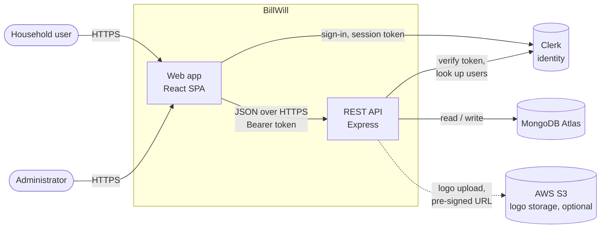

**External systems**

| System | Role | Failure impact |
|---|---|---|
| Clerk | Sign-in UI, session tokens, user directory (email, name, avatar) | No new sign-ins; API cannot verify tokens, so all authenticated calls fail |
| MongoDB Atlas | System of record | `/api/ready` returns 503; data routes return 500 with a generic message |
| AWS S3 | Optional branding logo storage | Logo upload returns 503; pasting an https logo URL still works |

---

## 4. Container architecture

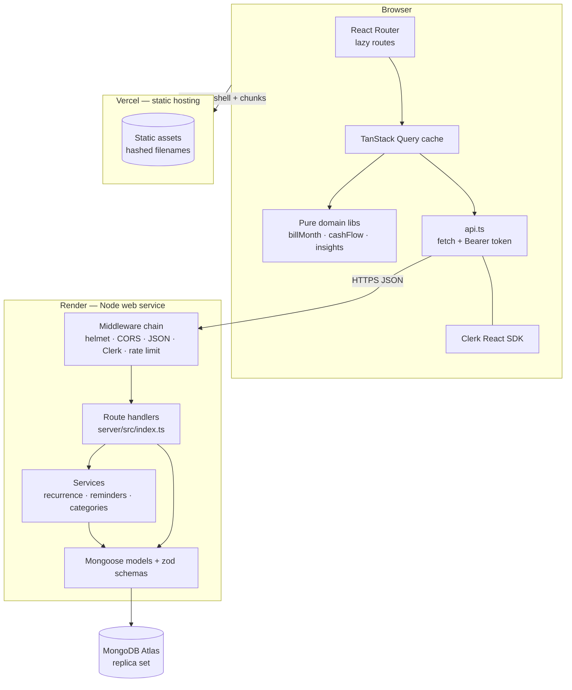

**Responsibilities**

| Container | Owns |
|---|---|
| Browser SPA | Presentation, navigation, client-side aggregation (month scope, projection, cash flow, insights), cache of API data |
| Vercel | Serving the compiled SPA, rewriting deep links to `index.html`, immutable caching of hashed assets |
| Express API | Authentication check, authorization, validation, business rules that must be enforced centrally (ownership, payments, plans, categories), persistence |
| MongoDB | Durable state, uniqueness (indexes), multi-document transactions |

**Why aggregation is in the browser.** Totals such as Monthly Flow, free-to-spend and budget usage depend on the *selected month* and on *projected* bills and income that are never stored. Computing them next to the data the user is looking at avoids many parameterised endpoints and keeps the server stateless and simple. The cost is that figures are not available to non-browser clients; if that becomes a requirement the pure functions in `src/lib/` are the unit to move or share.

---

## 5. Technology stack

| Layer | Technology | Notes |
|---|---|---|
| Frontend framework | React 18, TypeScript, Vite | SPA, route-level code splitting |
| UI | Tailwind CSS, shadcn/ui (Radix), Framer Motion, lucide icons | Tokens in [DESIGN.md](DESIGN.md) |
| Client data | TanStack Query, hand-written store hooks | Query keys shared between hooks |
| Forms / validation | zod, native inputs | Same library as the server |
| Routing | react-router | `ProtectedRoute`, `AdminRoute` guards |
| Auth (client) | Clerk React SDK | Token attached by `apiRequest()` |
| Backend | Node 24, Express 5, TypeScript (ESM, NodeNext) | `server/` is its own npm package |
| Auth (server) | `@clerk/express` | `clerkMiddleware`, `getAuth`, Backend API client |
| Persistence | MongoDB (Atlas), Mongoose 9 | Replica set for transactions |
| Validation | zod 4 | `.strict()` request schemas |
| Security | helmet, CORS allow-list, `express-rate-limit` | |
| Object storage | AWS SDK v3 (S3) | Optional |
| Tests | Vitest, mongodb-memory-server, Playwright | Unit, integration, browser |
| CI/CD | GitHub Actions; Vercel and Render deploy from git | |
| Container option | Dockerfile + nginx (Coolify) | See [COOLIFY.md](COOLIFY.md) |

### 5.1 Technology deep dive — how each piece solves a BillWill problem

The table above is the "what". This section is the "why and how", written so you can read it top to bottom and learn. Each technology follows the same pattern: **the problem**, **what the technology is**, **how BillWill uses it (and where)**, **facts worth knowing**, and **which tests cover it**. File paths are relative to the repository root.

A mental model first. BillWill is like a small restaurant:

- the **browser app** is the dining room (what the customer sees and touches);
- the **API** is the kitchen (it does the real work and enforces the rules);
- **MongoDB** is the pantry and the recipe book (everything that must be remembered);
- **Clerk** is the doorman who checks who you are (the kitchen never sees passwords);
- **tests** are the health inspector who keeps visiting.

#### 5.1.1 TypeScript — one language, with a safety net

*Problem.* Money apps break in quiet ways: a field is spelled `dueDate` in one place and `due_date` in another, or an amount arrives as the text `"500"` instead of the number `500`. JavaScript only notices at runtime, in front of the user.

*What it is.* TypeScript is JavaScript plus **types**: you declare what shape data has (`amount: number`), and a compiler (`tsc`) refuses to build if code disagrees. Types are erased at build time, so they cost nothing at runtime.

*How BillWill uses it.* Both the frontend (`src/`) and the API (`server/src/`) are TypeScript, with strict settings. The compiler therefore checks that a screen using a bill and the server returning a bill agree on field names. `npm run typecheck` runs the compiler over the app, the build configs, the tests and the end-to-end harness. The server compiles to plain JavaScript in `server/dist` (`npm run build --prefix server`) and Render runs that output.

*Worth knowing.*
- **Types are not validation.** A type says what the data *should* be; it cannot stop a hacker sending something else over the network. That is why the API *also* validates every request at runtime with zod (§5.1.4). Both are needed.
- The server is an **ES module** project (`NodeNext`): imports of local files end in `.js` even though you write `.ts`. That looks odd but is correct.

*Tests.* `npm run typecheck` is itself a safety check and runs in CI on every push.

#### 5.1.2 Node.js and Express — the API (the "kitchen")

*Problem.* The browser must not talk to the database directly (it would expose credentials and let any user read any data). Something trusted has to sit in between, check who is asking, apply business rules, and return only what that person may see.

*What it is.* **Node.js** runs JavaScript on a server. **Express** is a small framework on top: you register a *route* (a method plus a path, such as `GET /api/bills`) and a *handler* function; requests flow through a chain of *middleware* (small functions that can inspect, change or reject a request) before reaching the handler.

*How BillWill uses it.* `server/src/index.ts` builds the Express app. The chain, in order, is: trust-proxy setting → `helmet` (security headers) → CORS → JSON body parser (100 kB cap) → health endpoints → Clerk authentication → rate limiter → your route → JSON 404 → error handler (§6.2). Every route follows the same handler recipe (§6.3): get the signed-in user, validate input, query with that user's id, return a clean DTO. Business logic that is shared or complex lives in `server/src/services/` (recurring bills, reminders, categories).

*Worth knowing.*
- **Order matters.** Health checks are registered *before* authentication so Render's probe is never blocked; the rate limiter comes *after* Clerk so it can count per user rather than per IP.
- **Express 5** catches errors thrown inside `async` handlers and forwards them to the error handler; the code still wraps handlers in `try/catch` so it can return friendly messages.
- `TRUST_PROXY=1` on Render tells Express there is one load balancer in front, so `req.ip` is the real client and not Render's proxy. Get this wrong and either rate limiting treats all users as one, or users can fake their IP.
- The API is **stateless**: nothing about a user's session is kept in memory, so a second copy of the server would behave identically.

*Tests.* `src/test/api-error-handling.test.ts` (JSON 404s, malformed JSON, oversized bodies, health/ready, rate limiter against the real app on a local port); `server-resilience.test.ts` (startup failure and graceful shutdown); `env-config.test.ts` (refuses to boot on bad configuration); every integration test drives the real app over HTTP.

#### 5.1.3 MongoDB and Mongoose — remembering things

*Problem.* Bills, payments, plans, income and budgets must survive restarts, be queried quickly per user, and sometimes be written together so that a half-finished write never leaks out.

*What it is.* **MongoDB** is a *document database*: instead of tables and rows it stores JSON-like documents in *collections*. **MongoDB Atlas** is the hosted service. **Mongoose** is the library the API uses: you describe each collection's fields once (a *schema*), and Mongoose gives you typed read/write functions, default values, field-level validation, and **indexes**.

*How BillWill uses it.* One file per collection in `server/src/models/`. Every user-owned document has a `userId` string (the Clerk id) and every query includes it. Indexes enforce rules the database itself guarantees: one recurring occurrence per series per month (`seriesId + billingCycle`), one payment per idempotency key per user, one budget per user and category (§8.2). A **transaction** makes installment-plan creation all-or-nothing: either the plan and all its bills are saved, or nothing is.

*Worth knowing.*
- **No foreign keys.** MongoDB will happily keep a bill whose category was deleted. BillWill therefore enforces such rules in code (§8.3), for example refusing to delete a category that bills still use.
- **Transactions need a replica set.** Atlas always is one. A plain local `mongod` is not, so the code has a slower sequential fallback (§8.5).
- **Unique index = race-proof.** If two browser tabs ask for the same month's recurring bills simultaneously, the unique index lets only one insert win; the other gets a duplicate-key error that the code treats as "already done". This is why generating bills on read is safe without a scheduler.
- **Schema changes need no migration script.** Adding a field with a default (like category `kind`) leaves old documents untouched; the code supplies the default when reading (`defaultKindForSlug`).
- Money is stored as a plain JavaScript number and rounded to two decimals in calculations (`round2`). That is adequate at household scale; at accounting scale you would store integer paise.

*Tests.* `src/test/integration/*` run the real app against a genuine in-memory MongoDB replica set: `installments-payments.test.ts` (transaction rollback, idempotency, partial payments), `core-features.test.ts` (recurring scopes, concurrent generation without duplicates), `categories.test.ts`, `budget.test.ts`. Pure schema tests are in `installments-backend.test.ts`, `subscriptions-backend.test.ts`, `payments-backend.test.ts`, `pricing-backend.test.ts`, `categories-backend.test.ts`.

#### 5.1.4 zod — never trust what the network sends

*Problem.* Anyone can call the API with any JSON, not only your own screens. Unchecked input leads to corrupted data, crashes, and attacks such as sending `{"amount": {"$gt": 0}}` hoping the database interprets it as a query.

*What it is.* zod is a runtime validation library: you declare the exact shape you accept (`amount` is a positive number up to a limit, `category` matches a pattern) and `safeParse` returns either clean, typed data or a list of problems.

*How BillWill uses it.* Each model file exports its request schemas next to the database schema (for example `createIncomeSchema`, `budgetSettingsUpdateSchema`). They are built with `.strict()`, which **rejects unknown fields** — so a request containing `userId`, `role` or `isActive` where it is not allowed fails with 400. Budget settings use a refinement: needs + wants + savings must equal 100. The frontend uses zod too, so forms show the same messages before anything is sent.

*Worth knowing.* The server uses zod 4 and the frontend zod 3; the schemas are separate and deliberately duplicated at the edges (the server is the authority, the browser copy is convenience).

*Tests.* Every `*-backend.test.ts`, `bills-hardening.test.ts`, `budget-cashflow.test.ts` (schema section), and the integration `request-validation.test.ts`, which fires malformed IDs, operator injection and invalid fields at every route.

#### 5.1.5 Clerk — identity without storing passwords

*Problem.* Passwords, Google sign-in, session expiry and account recovery are hard to build safely, and a leak would be catastrophic.

*What it is.* Clerk is a hosted identity service. The browser SDK shows the sign-in UI and holds the session; after sign-in it can hand out a short-lived **session token** (a signed JWT — a tamper-proof ticket that says "this is user_123, issued to this website, expires soon").

*How BillWill uses it.* The frontend (`src/contexts/AuthContext.tsx`, `src/lib/api.ts`) attaches the token to every API call as `Authorization: Bearer <token>`. On the server, `clerkMiddleware` checks the signature and expiry and that the token was issued to one of our own origins (`authorizedParties` = `CLIENT_URL`), then `getAuth(req)` gives the handler the user id. The API never sees a password. A user's email, name and avatar are copied into the `users` collection at most every 15 minutes. **Admin** status comes from either the `ADMIN_CLERK_USER_IDS` environment variable (always on, checked every request) or `role: "admin"` in MongoDB (set from Admin → Users).

*Worth knowing.*
- The **publishable key** (`pk_…`) is public and ships in the frontend; the **secret key** (`sk_…`) is server-only. Frontend and backend must use the *same* Clerk instance or every call returns 401.
- Because the token travels in a header (not a cookie), browsers do not attach it automatically to requests from other sites, which is why CSRF attacks do not apply here (§12).
- Roles are never cached: revoke someone and they lose access on their next request.

*Tests.* `clerk-authorized-parties.test.ts` (real Clerk middleware with locally signed tokens: wrong origin rejected), `user-role-backend.test.ts`, `user-role-hook.test.ts`, `admin-users-backend.test.ts`, integration `admin-roles.test.ts`, `profile-sync.test.ts`, `auth-boundaries.test.ts`. In tests Clerk is replaced by a header-based stand-in (`fakeClerk.ts`, `e2e/fullstack/fake-clerk-react.tsx`); real Clerk is exercised only by the signed-out smoke tests (§16).

#### 5.1.6 React — building the screens

*Problem.* A dashboard changes constantly: marking a bill paid should update the table, totals, chart, reminders and cash flow at once, without hand-editing each piece of the page.

*What it is.* React is a UI library built on one idea: **the screen is a function of state**. You write components (small functions that return what to show for the current data); when data changes React redraws only what differs. *Hooks* (`useState`, `useMemo`, custom hooks) hold state and logic inside components.

*How BillWill uses it.* Pages in `src/pages/` compose components from `src/components/`; custom hooks in `src/hooks/` fetch and change data (`useBillStore`, `useBudget`, `useCategories`). Heavy arithmetic is kept out of components in **pure functions** (`src/lib/billMonth.ts`, `cashFlow.ts`, `insights.ts`): same input, same output, nothing hidden. Components call them inside `useMemo`, so totals are recomputed only when bills, income or the selected month change.

*Worth knowing.*
- React escapes text automatically, so a bill named `<script>…` is shown as text, not run. The only raw-HTML use in the app is shadcn's chart style helper, fed by admin-validated hex colours.
- Pure functions are easy to test without a browser, which is why the budgeting rules are unit tested directly (`budget-cashflow.test.ts`) rather than through screens.

*Tests.* Hook and store tests (`subscriptions-frontend.test.ts`, `installments-frontend.test.ts`, `notifications-frontend.test.ts`, `user-role-hook.test.ts`, `currency-ui.test.tsx`), plus the Playwright journeys that click through real pages.

#### 5.1.7 Vite — building and serving the frontend

*Problem.* Browsers cannot run TypeScript or JSX, and shipping hundreds of small files is slow.

*What it is.* Vite is the build tool. In development it serves files instantly with hot reload; for production it bundles the app into a few minified files whose names contain a content hash (`AdminCategories-a1b2c3.js`).

*How BillWill uses it.* `npm run build` produces `dist/`. `vite.config.ts` **refuses to build** if `VITE_API_URL` is missing or not https, or the Clerk key is missing — preventing a deployed app that silently calls `localhost`. Pages load lazily (`React.lazy`), so each admin or budget page is its own chunk downloaded on first visit.

*Worth knowing.* Hashed filenames let Vercel cache assets forever, but they cause the "blank page after deploy" problem: an old tab asks for a chunk that no longer exists. `src/lib/chunkReload.ts` and `ChunkErrorBoundary` solve it with one automatic reload (§7.5). Variables starting `VITE_` are baked into the public bundle — never put secrets in them.

*Tests.* `deploy-readiness.test.ts` (config drift, the Clerk stand-in never reaching the normal build), `env-config.test.ts` (API URL and key rules), `chunk-reload.test.ts`.

#### 5.1.8 React Router — pages and guards

*Problem.* A single-page app needs real URLs (`/budget/income`) that survive reload, and some pages must be blocked for the wrong user.

*What it is.* React Router maps URLs to components without reloading the page.

*How BillWill uses it.* `src/App.tsx` declares all routes. `ProtectedRoute` sends signed-out visitors to `/login`; `AdminRoute` sends non-admins to `/dashboard`. The Budget section is a *nested route*: `BudgetLayout` draws the header and tabs, and `income`, `budgets`, `settings` render inside it. Vercel rewrites every path to `index.html` so deep links work on refresh.

*Worth knowing.* Route guards are **user-experience only**. A determined user can still call the API directly, which is why every API route re-checks identity and role. Front-end hiding is never the security boundary.

*Tests.* `user-role-hook.test.ts` plus the admin redirect journeys in `e2e/fullstack/journeys.spec.ts`; the smoke tests check signed-out redirects.

#### 5.1.9 TanStack Query — keeping server data fresh

*Problem.* The same bills appear in the table, the Upcoming widget, the Cash Flow card and the Budgets tab. Each needs loading and error states, caching, and a refresh after any change.

*What it is.* A cache for server data. You give a query a key (`['bills']`); anyone asking for that key shares one request and one cached copy. After a change you *invalidate* the key and every screen using it refetches.

*How BillWill uses it.* Hooks wrap each API resource. The month-aware hooks (`useMonthBills`) reuse the `['bills']` and `['subscriptions']` keys, so switching months does not refetch; it re-derives from cache. Budget hooks own `income`, `budgets` and `budget-settings` keys and invalidate them after every save. Notifications poll every 60 seconds.

*Worth knowing.* A wrong or duplicated key is the classic bug: two screens that think they show "the bills" but cache separately will disagree. Reusing keys is a deliberate design rule here.

*Tests.* Hook tests listed under React; behaviour is also proven by the journeys (add a bill, see it everywhere).

#### 5.1.10 Tailwind CSS, shadcn/ui and Radix — the look and feel

*Problem.* Consistent, accessible, responsive UI without hand-writing thousands of lines of CSS.

*What it is.* **Tailwind** styles elements with small utility classes (`rounded-3xl p-6`). **Radix** provides unstyled, accessible behaviour (dialogs, selects, switches with keyboard and screen-reader support). **shadcn/ui** is a set of ready components built from the two, copied into `src/components/ui/` so you own the code.

*How BillWill uses it.* Colours are *semantic tokens* (`primary`, `destructive`, `muted-foreground`) defined as CSS variables, so admin theme settings can re-colour the whole app at runtime. Layout is a responsive "bento" grid. The design rules are in [DESIGN.md](DESIGN.md).

*Worth knowing.* Never hard-code colours in components; use tokens, otherwise theme changes and dark/light mode break. Status is shown with text as well as colour, so colour-blind users are not left guessing (budget rows say "over by ₹800").

*Tests.* `theme.test.ts`; the full-stack journeys fail if key pages scroll horizontally at desktop, tablet or phone size.

#### 5.1.11 Recharts, Framer Motion, date-fns, sonner — supporting libraries

- **Recharts** draws the spending chart. **Framer Motion** animates entrances (every animation ≤ 0.3 s). **sonner** shows toast messages ("Category added"). **lucide-react** supplies icons.
- **date-fns** formats dates (`MMM dd, yyyy`) without time-zone surprises.

*Worth knowing about dates.* Due dates are stored at **UTC midnight**, so a bill due "5 Dec" is the same instant for everyone. Month grouping therefore uses UTC fields, while "what is the current month" uses the local clock. Mixing the two is the most common source of off-by-one-month bugs, which is why `src/lib/billMonth.ts` is the only place that does it and has a dedicated test file (`bill-month.test.ts`, covering month and year boundaries).

#### 5.1.12 Security middleware — helmet, CORS, rate limiting

*Problem.* Even a correct API can be abused: embedded in a hostile page, hammered with requests, or called from an unexpected website.

*What they are.* **helmet** adds protective HTTP response headers. **CORS** tells browsers which websites may call the API; here only the origins in `CLIENT_URL`. **express-rate-limit** counts requests and answers 429 when a client exceeds 1000 per 15 minutes (30 for admin role changes and logo uploads).

*Worth knowing.* CORS only restrains *browsers*; scripts and tools ignore it, which is why authentication and ownership checks are the real protection. Rate-limit counters live in memory per server instance (§15).

*Tests.* `api-error-handling.test.ts` (rate limiter and headers against the real app), integration `auth-boundaries.test.ts`, `deploy-readiness.test.ts` (CORS/config drift).

#### 5.1.13 AWS S3 and multer — logo uploads

*Problem.* Admins can upload a brand logo; user-supplied files are risky (fake extensions, huge files, scripts disguised as images).

*What it is.* **multer** reads multipart uploads into memory with a size cap. **S3** is Amazon's object store; the bucket is **private** and the API hands out **pre-signed URLs** (temporary links valid for one hour).

*How BillWill uses it.* The API accepts only PNG, JPEG or WebP, checks the file's actual first bytes (`services/imageSignature.ts`) instead of trusting the filename, caps size at 2 MB, stores under `branding/`, and rejects non-https logo URLs. Without AWS credentials the upload returns 503 and admins can paste an https URL instead.

*Tests.* `image-signature.test.ts`; integration `logo-upload.test.ts` (real files accepted, disguised files and oversize rejected, `PutObject` built).

#### 5.1.14 Testing tools — Vitest, mongodb-memory-server, Playwright

*Problem.* A finance app must not regress silently, and "it works on my machine" is not evidence.

*What they are.* **Vitest** runs fast unit tests. **mongodb-memory-server** starts a throwaway real MongoDB inside the test process. **Playwright** drives a real browser.

*How BillWill uses them.* The layers are described in §16 and [TESTING.md](TESTING.md). A key idea: integration tests read the route list **from the running app** and assert, for *every* route, that signed-out calls return 401 and non-admins get 403 on `/api/admin/*`. Add a new endpoint and forget the check, and the suite fails — you do not have to remember.

*Worth knowing.* Commands: `npm test` (unit), `npm run test:integration` (needs a one-off ~100 MB MongoDB download), `npm run test:e2e:fullstack` (browser journeys). Unit tests do **not** touch MongoDB; only the integration suite does.

#### 5.1.15 GitHub Actions, Vercel, Render — shipping

*Problem.* Getting code to users repeatably, with checks, and without manual copying.

*What they are.* **GitHub Actions** runs lint, type-check, tests and builds on every push (`.github/workflows/ci.yml`). **Vercel** and **Render** each watch the Git repository and rebuild/redeploy on push: Vercel serves the static frontend; Render runs the API (`render.yaml`).

*Worth knowing.* Deployment is **not** triggered by CI. Anything not committed and pushed to the deploy repository (`raj3176/billwill`, remote `personal`) does not exist for Vercel or Render — the cause of an earlier "my changes are missing" incident. Release order and rollback are in §13.1.

*Tests.* `deploy-readiness.test.ts` checks `render.yaml` and `vercel.json` against what the code expects.

#### 5.1.16 Docker and nginx (optional) — self-hosting

The `Dockerfile` builds the frontend and serves it with nginx; `nginx.conf` rewrites all routes to `index.html`. This is the alternative to Vercel when self-hosting on a VPS with Coolify ([COOLIFY.md](COOLIFY.md)). It is not used by the current Render/Vercel deployment.

### 5.2 From business problem to code to tests

This map answers "where in the code is this feature, and what would fail if it broke?".

| Business need | Where it lives | Rules enforced | Covered by |
|---|---|---|---|
| Only I can see my bills | Every handler: `getAuth` + `{ userId }` filter (`server/src/index.ts`) | 401 signed out, 404 for others' ids | `auth-boundaries`, `data-isolation`, `request-validation` (integration) |
| Admin-only actions | `requireAdminAuth`; env allow-list + DB role | 403 for non-admins; roles never cached | `admin-roles` (integration), `admin-users-backend`, `user-role-backend` |
| Add/edit a bill | `POST/PATCH /api/bills`, `Bill` model, `BillDialog.tsx` | positive amount, valid date, active category | `bills-hardening`, `core-features`, `categories` |
| Record a payment safely | `POST /api/bills/:id/payments`, `Payment` model | idempotency key, 4 s duplicate guard, partial vs full | `payments-backend`, `installments-payments` |
| Subscriptions that renew monthly | `recurrenceService.ts`, `RecurringSeries` | one occurrence per month (unique index), month-end clamp, `this/future/all` scopes | `recurring-bills`, `subscriptions-backend`, `core-features` |
| EMI / installment plans | `POST /api/installments`, `InstallmentPlan` | transaction, rollback, balance updates, cancel keeps paid | `installments-backend`, `installments-phase3d`, `installments-payments` |
| Reminders | `reminderService.ts`, `Notification` | one per bill and type, due within 5 days, cleared on payment | `notifications-backend`, `legacy-reminders`, `core-features` |
| See any month correctly | `src/lib/billMonth.ts`, `useMonthBills` | due-month in UTC, carried-over unpaid, projected recurring | `bill-month.test.ts` |
| Admin manages categories | `Category` model, `categoryService.ts`, `AdminCategories.tsx` | unique name, hide not delete when used, ≥1 active, kind | `categories-backend`, `integration/categories` |
| Income and "free to spend" | `IncomeSource`, `cashFlow.ts`, `CashFlowCard.tsx` | month-end clamp, end dates, count-in-plan, savings kind | `budget-cashflow`, `integration/budget` |
| Category limits and split | `Budget`, `BudgetSettings`, `BudgetsTab.tsx` | limit > 0, 80% warn, split sums to 100 | `budget-cashflow`, `integration/budget` |
| Branding, theme, pricing | `SiteSettings`, `PricingTier`, admin pages | HSL validation, https logo, hidden tiers admin-only | `pricing-backend`, `theme`, `public-endpoints`, `logo-upload` |
| Safe configuration | `config/env.ts`, `vite.config.ts` | refuse to start/build when invalid | `env-config`, `deploy-readiness` |
| Survive new deployments | `chunkReload.ts`, `ChunkErrorBoundary` | one reload, no loop | `chunk-reload.test.ts` |
| Rupee display | `src/lib/currency.ts` | Indian digit grouping, compact `₹1.2Cr` | `currency.test.ts`, `currency-ui.test.tsx` |
| Insights | `src/lib/insights.ts` | fixed rules, no AI | `insights.test.ts` |

---

## 6. Backend design

### 6.1 Module structure

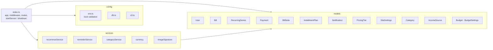

`server/src/index.ts` composes the Express app, registers all routes, and exports `startServer()` and helpers used by tests. Models contain the Mongoose schema **and** the zod request schemas for that resource, so the shape of a resource and its accepted input live together. Services hold logic that is shared between routes or that is non-trivial: recurring generation, reminder generation, category lookup and rules.

### 6.2 Request pipeline

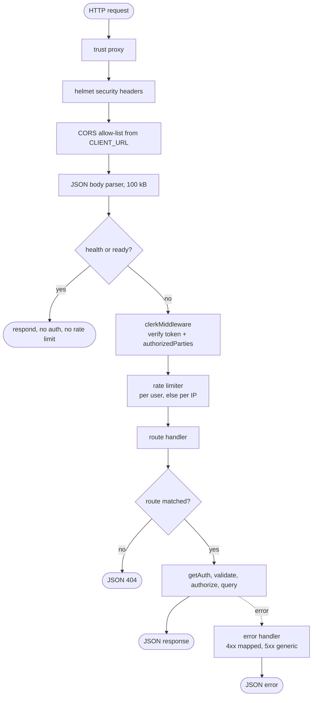

Every error is `{ "error": "<message>" }`. A 5xx never exposes internals; the detail is only in the server log.

### 6.3 Handler pattern

Every user-owned route follows the same steps, which is what the automated sweeps rely on:

1. `getAuth(req)`; no `userId` → `401 { error: "Authentication required." }`.
2. Validate any `:id` / `:slug` shape; malformed → `400`.
3. Parse the body with a **strict** zod schema; unknown or invalid fields → `400` with the first message.
4. Check cross-resource rules (for example `getCategoryProblem` for a category).
5. Query with `{ _id, userId }`; no match → `404` (so another user's id is indistinguishable from a missing one).
6. Respond with a DTO, never the raw document.

Admin routes call `requireAdminAuth` first (`401` / `403`).

### 6.4 Startup and shutdown

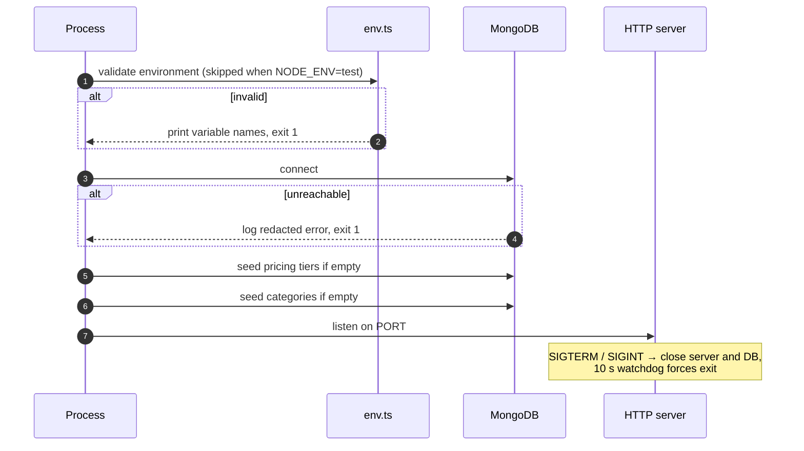

Seeding uses upserts keyed on the unique slug and only runs against an **empty** collection, so concurrent starts cannot duplicate rows and admin deletions are never undone.

---

## 7. Frontend design

### 7.1 Layers

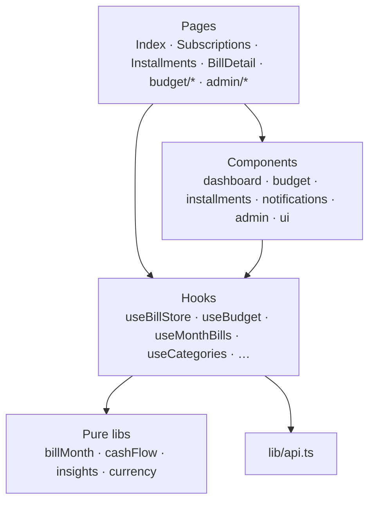

Rules: pages compose components; hooks own server state (TanStack Query) and expose small command functions; `src/lib/` contains **pure, framework-free functions** that are unit-tested directly; only `api.ts` touches `fetch`.

### 7.2 Routing

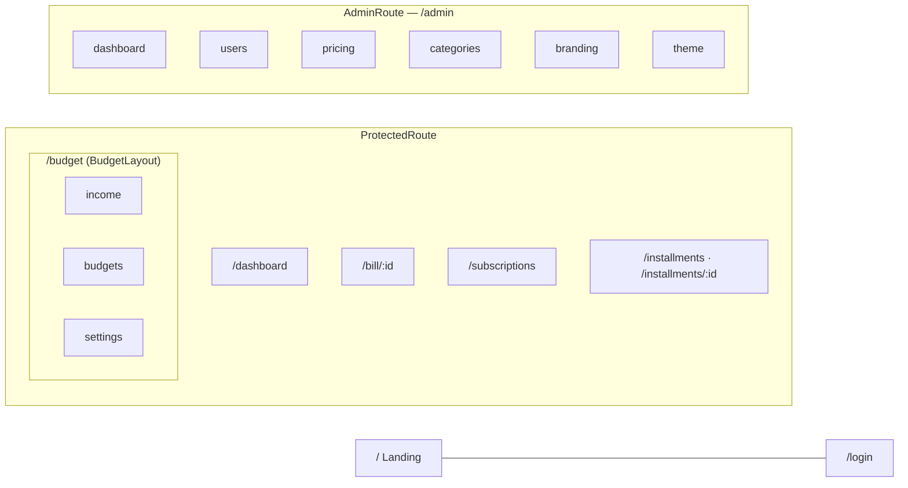

Signed-in and admin pages are lazy-loaded, so the landing page does not download the dashboard or admin code.

### 7.3 State and caching

- Server state lives in TanStack Query. Bills and subscriptions use the keys `['bills']` and `['subscriptions']`; the month-aware hooks reuse them so every screen shares one fetch.
- Budget data has its own keys (`income`, `budgets`, `budget-settings`), invalidated after each mutation.
- Categories are fetched once and cached; `useCategories` exposes `optionsFor(current)` (active categories plus the bill's own, possibly hidden, category), `getLabel` and `getColor`.
- Notifications poll every 60 s.
- Light/dark preference is the only data kept in `localStorage`.

### 7.4 Month-scoped views

The dashboard and the Budget pages operate on a *selected month* (`useMonthSelector`). Data for that month is derived by `useMonthBills` from the cached bills and subscriptions (see §9.5). All dashboard widgets receive the derived list, so Monthly Flow, Upcoming, the Cash Flow card and the Budgets tab can never disagree about which bills belong to the month.

### 7.5 Resilience to new deployments

A tab left open across a release can request a lazy chunk that no longer exists. `installChunkErrorReload()` listens for Vite's `vite:preloadError`, and `ChunkErrorBoundary` catches failed dynamic imports. The first failure triggers one reload, guarded by a timestamp in `sessionStorage` so it cannot loop; a repeat failure shows a message with a manual reload button instead of a blank page.

---

## 8. Data design

### 8.1 Entity relationships

All user-owned documents carry `userId` (the Clerk user id, a string). There are no cross-user references.

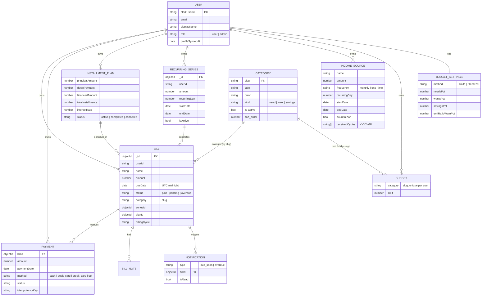

Global (not per-user) collections: `Category`, `PricingTier`, `SiteSettings` (single document). `Category` is global because admins curate one list for everyone.

### 8.2 Collections

| Collection | Key constraints and indexes | Notes |
|---|---|---|
| `users` | unique `clerkUserId` | `role` only changed by grant/revoke; profile copied from Clerk at most every 15 min |
| `bills` | `userId`; `seriesId`; unique partial indexes for **one occurrence per series per billing cycle** and **one bill per plan installment number** | `dueDate` stored at UTC midnight; `category` is a slug matching `^[a-z0-9]+(-[a-z0-9]+)*$` |
| `recurringseries` | `{userId, isActive}` | Monthly only; `recurringDay` 1–31 with month-end clamping |
| `payments` | `{userId, billId, paymentDate desc, createdAt desc}`; unique per-user `idempotencyKey` (partial) | Partial payments allowed |
| `billnotes` | `{userId, billId, createdAt desc}` | Text 1–1000 chars |
| `installmentplans` | `{userId, status, createdAt desc}`; unique per-user `idempotencyKey` (partial) | 2–120 installments, interest 0–100 |
| `notifications` | unique `{userId, billId, type}`; per-user list index on dismissed/read/created | One `due_soon` and one `overdue` per bill |
| `pricingtiers` | unique `slug` | Seeded when empty |
| `sitesettings` | unique `settingsId` | Single document `default` |
| `categories` | unique `slug`; index on `sort_order` | 12 defaults seeded when empty; `kind` default `need` |
| `incomesources` | `userId` | Amount > 0, name ≤ 100, `receivedCycles` of `YYYY-MM` |
| `budgets` | unique `{userId, category}` | `limit` > 0, ≤ 1,000,000,000 |
| `budgetsettings` | unique `userId` | Created on first save; GET returns defaults when absent |

### 8.3 Referential integrity

MongoDB has no foreign keys, so integrity is enforced in code:

- **Categories are referenced by slug and never reused.** A category cannot be deleted while any bill, recurring series or installment plan uses it (`409`); admins hide it instead. Assigning a hidden or unknown category is rejected, but an unchanged value on an existing record is always accepted so old bills stay editable.
- **At least one category must stay active** (checked on hide and delete).
- Budget limits for a category survive the category being hidden; the Budgets view keeps showing any category that has a limit or spend.
- Deleting a bill leaves its payments and notes (known limitation, §18).

### 8.4 Computed instead of stored

| Value | Why not stored |
|---|---|
| Income occurrences for any month | Fully determined by the source's day, start and end dates; nothing to generate, expire or repair |
| Bills for months beyond next month | Projected from active series on demand; avoids creating rows for months that may never matter |
| Spent, free-to-spend, savings rate, EMI share, budget usage | Pure functions of bills, income, settings and the selected month |

Only *facts the user declared* are stored: sources, receipts, limits, settings.

### 8.5 Consistency

- **Installment plan creation** writes the plan and its bills in one MongoDB transaction. On a standalone server (no replica set) the API falls back to sequential writes and deletes the plan if inserting bills fails.
- **Payments**: a repeated `idempotencyKey` returns `409`; an identical payment within 4 s is rejected as a duplicate. Completed payments that cover the amount mark the bill `paid` and update the plan's paid and remaining balance; a plan becomes `completed` when nothing remains.
- **Recurring generation** is idempotent: the unique index on series and billing cycle means concurrent list requests create each occurrence once.

---

## 9. Domain logic

### 9.1 Bill lifecycle

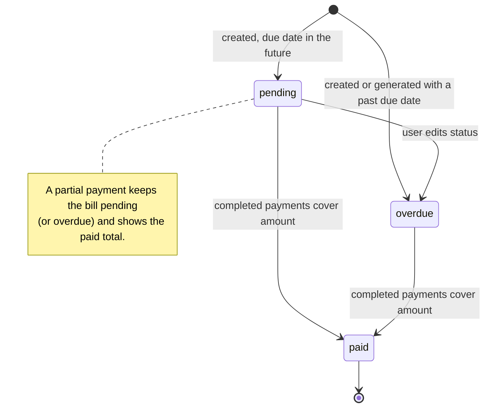

Status is a stored field, not recomputed by a timer (there is no scheduler). It is set by the user, set at creation or generation (a past due date starts as `overdue`), and set to `paid` by payments. The reminder service treats an unpaid bill with a past due date as overdue for notifications regardless of the stored value.

### 9.2 Recurring bills

A `RecurringSeries` represents a subscription. `generateDueOccurrencesForUser` runs whenever the user lists bills, subscriptions or notifications:

1. For each active series, compute the billing cycles (`YYYY-MM`) from the start date up to **next month**.
2. For each cycle, the due date is `recurringDay` in that month, clamped to the month's last day (31 → 28/29/30).
3. Insert missing occurrences; the unique series-and-cycle index makes this safe under concurrency.

Edits and deletes take a **scope**: `this` (one occurrence), `future` (this and later unpaid occurrences, and the series), or `all`. Paid occurrences are never deleted by `future`. Installment bills cannot be deleted individually; cancel the plan.

### 9.3 Installment plans

`financed = principal − downPayment`. Interest is a flat annual rate on the financed amount. The plan creates `totalInstallments` monthly bills, linked by `planId`, in the plan's category (default `finance`). Cancelling deletes unpaid installments and keeps paid ones. Paying an installment reduces the plan's remaining balance.

### 9.4 Reminders

`reminderService` runs when notifications are listed: a bill due within 5 days gets one `due_soon` notification; a past-due unpaid bill gets one `overdue` notification. Uniqueness is per user, bill and type. Notifications are cleared when the bill is paid or deleted. Reminders are in-app only.

### 9.5 Month scoping and projection (`src/lib/billMonth.ts`)

For a selected month *M*:

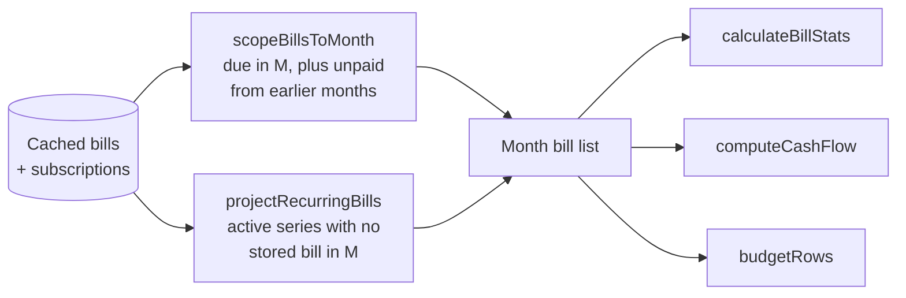

- *Scoped bills*: bills whose due month is *M*, plus unpaid (pending or overdue) bills from earlier months, flagged as carried over.
- *Projection*: for each active series that has no stored occurrence in *M* and whose start/end dates allow it, a read-only virtual bill is built (day clamped, status pending). Only needed for months beyond next month, because the server already materialises up to next month.
- Due dates are UTC midnight, so due months are matched in UTC. "Current month" is based on local time, which is what the user means by "this month".

### 9.6 Cash flow (`src/lib/cashFlow.ts`)

Income occurrences for *M*: a monthly source occurs on its day (clamped to month length) when that date is on or after its start and not after its end; a one-time source occurs only in its own month; inactive sources are skipped. Each occurrence knows whether it is *counted* (`countInPlan`) and *received* (`receivedCycles` contains `YYYY-MM`).

For the month's bills:

| Quantity | Definition |
|---|---|
| `income` | Sum of **counted** occurrences |
| `received` | Sum of occurrences marked received |
| `saved` | Sum of bills whose category `kind` is `savings` |
| `bills` | Sum of all other bills |
| `free` | `income − bills − saved` (may be negative) |
| `savingsRate` | `saved / income` (0 if no income) |
| `billsShare` | `bills / income` (null if no income) |
| `emiRatio` | Sum of EMI bills `/ income` (null if no income) |

An **EMI bill** is one with a `planId` or in the `loans` category. The EMI pill turns to a warning when `emiRatio` exceeds the user's `emiRatioWarnPct` (default 40%).

### 9.7 Budget rows and kind summaries

`budgetRows` lists every active category plus any category that has spend or a limit. For each: `spent` (sum of the month's bills), `limit` (or none), `usage = spent / limit`, and a status:

| Status | Condition |
|---|---|
| `none` | no limit set |
| `ok` | usage below 80% |
| `warn` | 80% up to and including 100% |
| `over` | above 100% |

`kindSummaries` groups rows by category `kind` and, for each of need / want / savings, reports spent, the sum of limits ("planned"), and a target: `income × pct / 100` using the user's split (default 50/30/20). The split is shown only when the method is `50-30-20`; category limits work in both modes.

**Why bills are the only "spend".** The app has no expense ledger yet, so budgets measure committed bills. This is the central limitation of Phase 1 and the reason a quick "log a spend" entry is the first item on the roadmap.

### 9.8 Category kinds

Each category has a `kind` (`need`, `want`, `savings`) set by admins. Defaults: entertainment and software → want; savings → savings; everything else → need. Documents created before `kind` existed fall back to this mapping when read (`defaultKindForSlug`), so no migration is required.

---

## 10. Key runtime flows

### 10.1 Authenticated API call

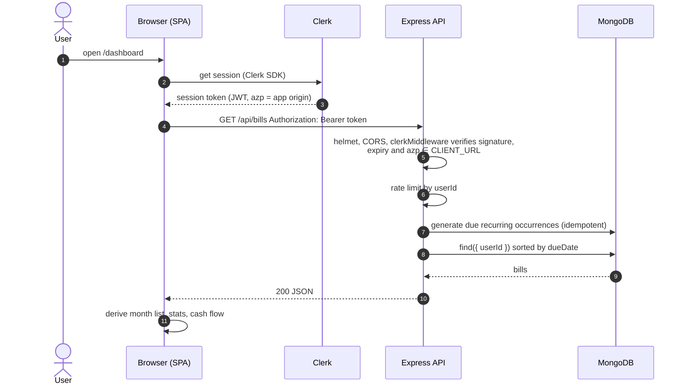

### 10.2 Record a payment

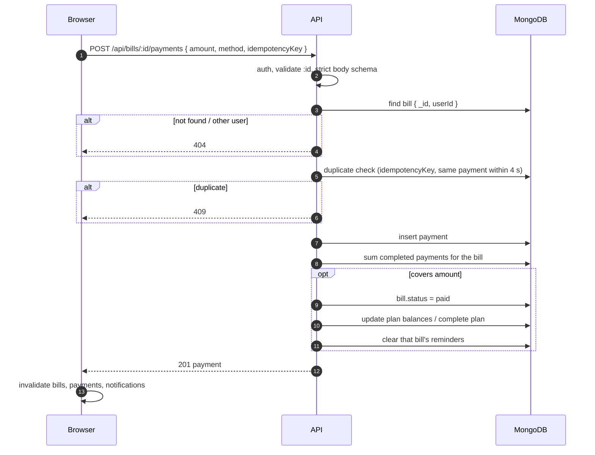

### 10.3 Create an installment plan

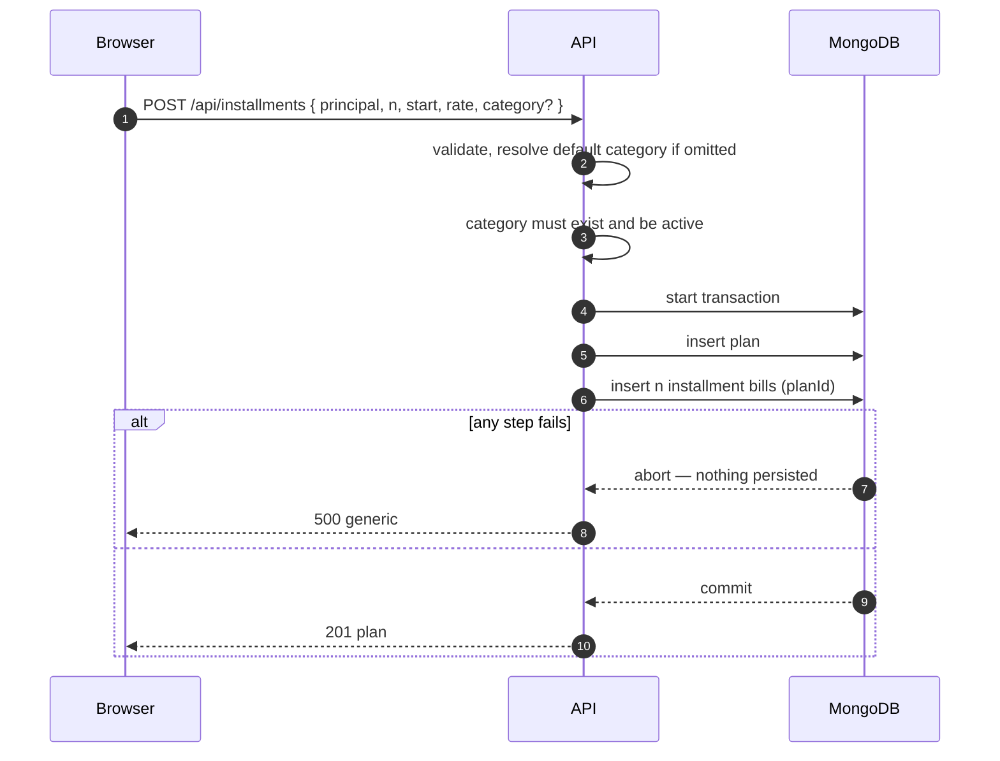

### 10.4 Save a budget limit

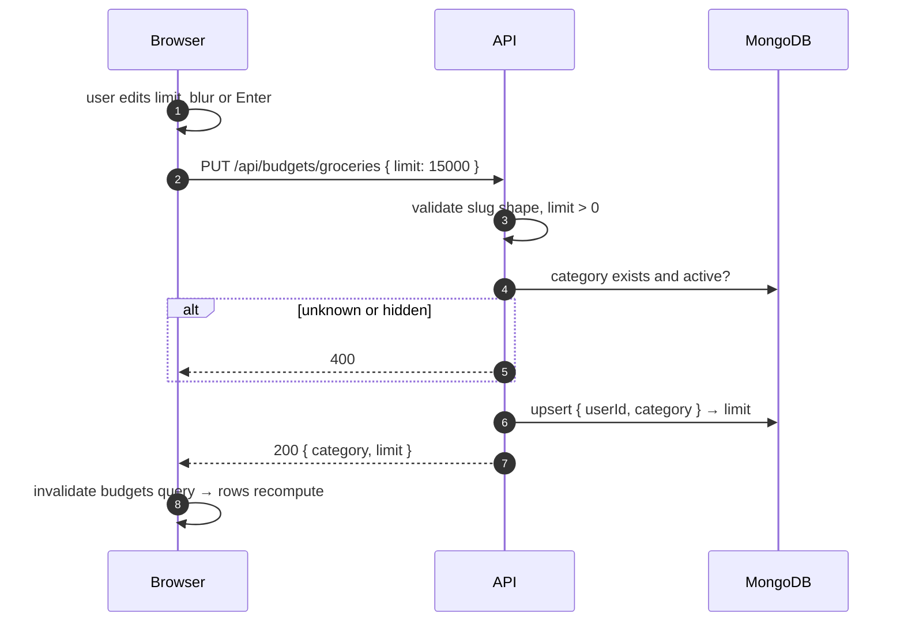

An empty input sends `DELETE /api/budgets/:slug` instead.

### 10.5 Stale chunk after a release

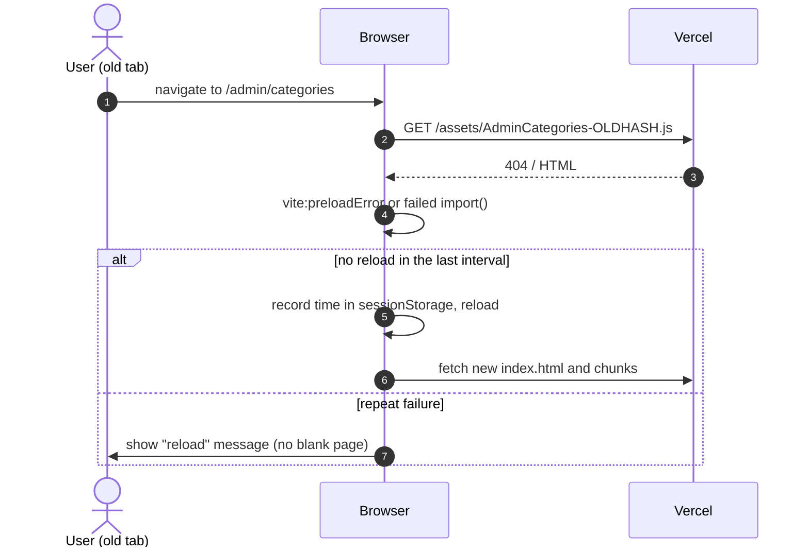

---

## 11. API design

The full endpoint list with request and response shapes is in [API.md](API.md). Principles:

- **REST-style JSON over HTTPS**, resources under `/api`. Verbs: `GET` read, `POST` create, `PATCH` partial update, `PUT` idempotent replace (budget limit, budget settings, income receipt), `DELETE` remove.
- **Ownership is implicit**: the user id is never accepted in a path, query or body (a body containing `userId` is rejected).
- **Strict schemas**: unknown fields are `400`.
- **Uniform errors**: `{ error }` with these statuses — 400 validation, 401 unauthenticated, 403 not admin, 404 not found or not yours, 409 conflict, 413 too large, 429 rate limited, 500 generic, 503 not ready.
- **Idempotency**: payments and installment plans accept an `idempotencyKey`.
- **Public surface** is limited to `/api/health`, `/api/ready`, `/api/site-settings`, `/api/pricing-tiers`.

| Resource group | Paths |
|---|---|
| Identity | `/api/users/me`, `/api/users/me/role` |
| Bills | `/api/bills`, `/api/bills/:id`, `/api/bills/:id/payments`, `/api/bills/:id/notes`, `/api/payments` |
| Subscriptions | `/api/subscriptions[...]` |
| Installments | `/api/installments[...]` |
| Notifications | `/api/notifications[...]` |
| Categories | `/api/categories`, `/api/admin/categories[...]` |
| Budgeting | `/api/income[...]`, `/api/budgets[...]`, `/api/budget-settings` |
| Site | `/api/site-settings`, `/api/pricing-tiers`, `/api/admin/*` |

---

## 12. Security design

### 12.1 Trust boundaries

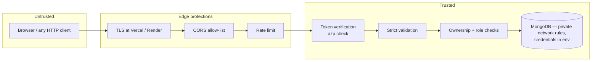

### 12.2 Controls

| Concern | Control |
|---|---|
| Authentication | Clerk session JWT in `Authorization: Bearer`; `clerkMiddleware` checks signature, expiry and that `azp` is one of the `CLIENT_URL` origins; tokens for other origins are treated as signed out |
| Authorization (data) | `userId` from the verified token on every query; other users' ids yield `404` |
| Authorization (admin) | `requireAdminAuth`: env allow-list `ADMIN_CLERK_USER_IDS` (evaluated on every request, never persisted) or `role: "admin"` in MongoDB; roles are never cached |
| Input validation | Strict zod schemas; `:id` shape checks; amounts bounded; body limited to 100 kB |
| Injection | Schema-validated primitives only; operator injection (`{"$ne": …}`) rejected and tested |
| Mass assignment | `.strict()` schemas reject unknown fields, including `userId`, `role`, `isActive` where not permitted |
| Transport | HTTPS only in production (frontend build refuses non-https API URLs) |
| Headers | `helmet` on the API; `X-Content-Type-Options`, `Referrer-Policy`, `X-Frame-Options` from Vercel |
| CORS | Only `CLIENT_URL` origins; no credentials/cookies are used |
| Abuse | 1000 requests / 15 min per user or IP; 30 / 15 min for admin role changes and logo uploads (per instance) |
| Uploads | Logo: PNG/JPEG/WebP only, checked by file signature, ≤ 2 MB; private S3 bucket with pre-signed URLs (1 h); logo URLs must be https |
| Secrets | Server-only env vars (`MONGODB_URI`, `CLERK_SECRET_KEY`, AWS keys); `VITE_*` values are public by design; credentials redacted from logs |
| Error disclosure | Generic 500 body; details only in server logs |
| Fail-fast config | Invalid environment stops the process before it serves traffic |

### 12.3 Threats considered

| Threat | Mitigation |
|---|---|
| User A reads or edits user B's data by guessing ids | Every query includes `userId`; sweep tests assert `404` and unchanged data |
| Forged or replayed token for another site | `azp` / authorized-parties check; short-lived Clerk tokens |
| Privilege escalation to admin | Role from DB/env only; grant/revoke admin-only and rate limited; self-revoke and bootstrap-admin protections |
| NoSQL operator injection | Strict typed schemas; tested |
| Oversized or malformed payloads | 100 kB limit; JSON errors mapped to 400/413 |
| Malicious file upload | Signature check, size cap, no direct public bucket |
| Brute force / scraping | Rate limits; Clerk handles credential attacks |
| Data loss from category changes | Deletion blocked while in use; hide instead |

### 12.4 Privacy

The API stores a minimal profile copied from Clerk (email, display name, avatar URL). Financial data is stored per user and is visible to no other user. There is no analytics or third-party tracking in the application code. Admin users can see the user list (profile fields), not other users' bills through the UI.

### 12.5 Web-application security posture

Security of the browser side and the data lifecycle, which §12.2 does not cover on its own.

| Topic | Position |
|---|---|
| **XSS** (hostile script in the page) | React escapes all text, including bill names, notes and admin-entered branding. The only `dangerouslySetInnerHTML` is shadcn's chart style helper (`src/components/ui/chart.tsx`), which receives colours validated as `#rrggbb` hex. Theme values are written with `style.setProperty` and are validated as HSL on the server. Logo URLs must be https. No Content-Security-Policy yet (see S6). |
| **CSRF** (another site making your browser call the API) | Not applicable by design: authentication is a Bearer token the app adds in JavaScript, not a cookie the browser sends automatically. CORS additionally limits browser callers to `CLIENT_URL`. |
| **Clickjacking** | `X-Frame-Options` set by Vercel on the SPA; `helmet` on the API. |
| **Token handling** | Tokens are short-lived and managed by the Clerk SDK; the API never stores them. Revocation and session expiry are Clerk's. |
| **Injection** | Strict zod schemas; query parameters (`status`, `scope`) are matched against allow-lists; category-name matching escapes regex characters (`escapeRegExp`); operator-injection payloads are rejected and tested (`request-validation.test.ts`). |
| **SSRF / outbound calls** | The API calls only Clerk, MongoDB and S3. User input is never used as a URL to fetch. |
| **Data at rest and in transit** | TLS everywhere in production; Atlas encrypts at rest; S3 bucket is private. |
| **Tenant isolation** | Row-level by `userId` in application code (MongoDB has no row-level security), enforced by route sweeps in tests. |
| **Secrets** | Environment variables on Render and Vercel only; `.env` files are git-ignored; server logs redact connection-string credentials; boot validation lists variable *names*, never values. |

### 12.6 Security review — gaps and recommendations (October 2026)

This review read the route list and handlers in `server/src/index.ts`, the request pipeline, the models, the upload path and the CI configuration. It is a design and code review, **not** a penetration test or dependency scan, and it did not run against the live system.

**What is solid.** Every non-public route checks the signed-in user; every user-owned query filters by `userId`; every `:id` is shape-checked; unknown body fields are rejected; list filters use allow-lists; admin routes call `requireAdminAuth`; uploads are signature-checked and size-capped; errors are generic; configuration fails closed. The endpoint matrix in Appendix A shows no unauthenticated data endpoint and no route missing an ownership filter.

**No critical or high-severity defects were found.** The gaps are hardening and operational maturity:

| ID | Gap | Severity | Evidence | Recommendation |
|---|---|---|---|---|
| S1 | **No audit trail of admin actions** (grant/revoke admin, category and pricing edits, branding changes) | Medium | No audit collection or structured log of who changed what | Add an `AuditLog` collection (actor, action, target, time) written by admin routes; show it in the admin dashboard |
| S2 | **No user data export or account deletion** | Medium (privacy) | No such endpoints; deleting a Clerk user leaves their MongoDB data behind | Add `DELETE /api/users/me` (removes all of the user's documents) and an export endpoint; also listen to Clerk's `user.deleted` webhook |
| S3 | **No per-user quotas** on bills, income sources, notes or payments | Low–Medium | Only the rate limit (1000 requests / 15 min) bounds growth; list endpoints return everything | Cap records per user (for example 5,000 bills, 50 income sources) with a clear 4xx; add pagination or month-range filters |
| S4 | **Rate limiting is coarse and per instance** | Low | One 1000/15 min bucket for reads and writes; counters in memory; Clerk-calling and generation-triggering endpoints are not limited more tightly | Tighter limits for writes and for `GET /api/admin/users`; a shared store (Redis) if more than one instance runs |
| S5 | **`/api/admin/users` pagination input not validated** | Low (admin only) | `Number(req.query.limit)` / `offset`: non-numeric `limit` silently falls back to fetching up to 500 users; a non-numeric `offset` reaches Clerk unchecked | Validate with zod (`int`, bounds) and return 400 |
| S6 | **No Content-Security-Policy on the SPA** | Medium (defence in depth) | `vercel.json` sets only `X-Content-Type-Options`, `Referrer-Policy`, `X-Frame-Options` | Add a CSP allowing self, Clerk, the API origin and fonts; add `Strict-Transport-Security` and `Permissions-Policy` explicitly; roll out in report-only mode first |
| S7 | **Raw HTML injection point in `chart.tsx`** | Low | `dangerouslySetInnerHTML` builds CSS from chart config | Keep colour inputs validated (they are); add a unit test asserting hex-only colours reach it |
| S8 | **No automated dependency, secret or code scanning** | Medium (process) | CI runs lint, typecheck, tests, builds only; open `npm audit` advisories noted in [HANDOVER.md](HANDOVER.md) | Enable GitHub Dependabot, secret scanning and CodeQL; run `npm audit --omit=dev` in CI |
| S9 | **No logging policy, monitoring or alerting** | Medium (detection) | About 70 `console.*` calls in the API, not reviewed for personal data; no structured logs, error tracking or alerts | Adopt structured logging with a rule against logging emails or amounts; add error tracking and an uptime monitor on `/api/ready` |
| S10 | **Admin accounts rely on Clerk settings for strong authentication** | Medium | Bootstrap admins are a plain list of ids | Require MFA for admin accounts in the Clerk dashboard; keep the list short |
| S11 | **Atlas network access may be wide open** | Medium if used | [DEPLOYMENT.md](DEPLOYMENT.md) permits `0.0.0.0/0` as an option | Restrict to Render's outbound IPs; use a least-privilege database user (read/write on one database only) |
| S12 | **Payment duplicate guard is check-then-insert** | Low (integrity) | The 4-second duplicate check is not atomic; protection is only complete when the client sends an `idempotencyKey` | Make the frontend always send a key (it does for normal flows); optionally add a unique index on a server-derived key |
| S13 | **Payments accept client-chosen `status` and overpayment** | Low (integrity) | Own data only; no cross-user effect | Decide the rule (for example reject overpayment) and enforce it server-side |
| S14 | **Public health endpoint reveals service name and database state** | Informational | `GET /api/health` | Acceptable for platform probes; remove the `database` field from the public response if you prefer |
| S15 | **Secrets rotation and incident process undocumented** | Low–Medium | No procedure in the docs | Document rotation of Clerk, MongoDB and AWS credentials and a basic incident checklist |
| S16 | **No backups configured by the application** | Medium (availability) | See §14.3 | Enable Atlas backups; test a restore |

**Suggested order of work.** (1) S8 and S10–S11, which are settings and CI changes costing almost no code; (2) S6 and S5, small code changes; (3) S1, S2 and S3, which add features; (4) S9 and S16 as operations work.

### 12.7 Security test coverage

| Control | Test |
|---|---|
| Every protected route returns JSON 401 signed out; every `/api/admin/*` route returns 403 for non-admins | `integration/auth-boundaries.test.ts` (route list read from the app) |
| Users cannot see or change each other's bills, payments, notes, plans, subscriptions, notifications | `integration/data-isolation.test.ts` |
| Malformed IDs return JSON 4xx, never 500; owner ids in query or body ignored or rejected; operator injection rejected | `integration/request-validation.test.ts` |
| Token issued to another origin is rejected | `clerk-authorized-parties.test.ts` |
| Admin grant/revoke, self-revoke and bootstrap protection, immediate loss of access | `integration/admin-roles.test.ts`, `admin-users-backend.test.ts` |
| Upload safety (signature, size, type mismatch) | `image-signature.test.ts`, `integration/logo-upload.test.ts` |
| Generic 500s without internals, malformed JSON, body-size limit, rate limit | `api-error-handling.test.ts`, `integration/core-features.test.ts` |
| Fail-closed configuration | `env-config.test.ts`, `server-resilience.test.ts` |
| New income / budget / category routes | covered automatically by the sweeps above, plus `integration/budget.test.ts`, `integration/categories.test.ts` |

**Not covered by any automated test:** CSP and browser-header behaviour in production, rate-limit behaviour across multiple instances, dependency vulnerabilities, and real Clerk token verification against Clerk's live service.

---

## 13. Deployment architecture

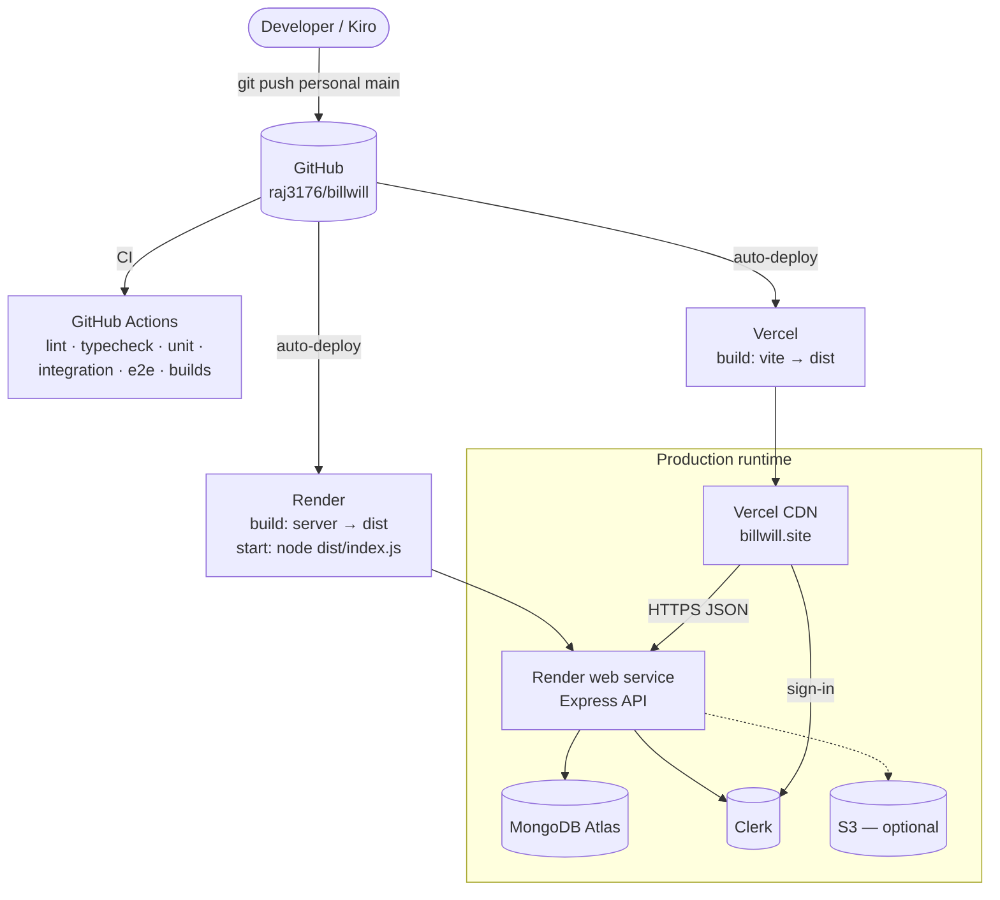

| Aspect | Detail |
|---|---|
| Frontend | Vercel builds with `npm run build`; the build **fails** if `VITE_API_URL` or `VITE_CLERK_PUBLISHABLE_KEY` is missing or invalid; all routes rewrite to `index.html`; `/assets/*` are immutable (content-hashed) |
| Backend | Render Blueprint `render.yaml`: root `server`, `npm ci --include=dev && npm run build`, `npm start`, health check `/api/ready`, `TRUST_PROXY=1`, `NODE_VERSION=24` |
| Database | Atlas replica set (needed for transactions); network access limited to Render outbound IPs where possible |
| Alternative | Docker/nginx for the frontend and a Node container for the API on a VPS with Coolify ([COOLIFY.md](COOLIFY.md)) |
| Config | Environment variables listed in [DEPLOYMENT.md](DEPLOYMENT.md#environment-variables); no secrets in the repository |

### 13.1 Release procedure

1. Merge to `main` (CI green). The deploy source is the personal repository remote `personal`.
2. Render deploys the API; wait for `/api/ready` to return 200.
3. Vercel deploys the frontend (the new UI calls endpoints that exist only in the new API).
4. Confirm both platforms show the same commit; run the post-deploy checklist.
5. Mongoose creates new collections and indexes on first use; no data migration script exists or is needed for current changes.

**Rollback:** redeploy the previous commit on each platform (frontend first if the API change was additive, since old API + new UI is the dangerous pairing). Data written by newer versions (new collections) is ignored by older code.

### 13.2 Environments

| Environment | Frontend | API | Database | Clerk |
|---|---|---|---|---|
| Local | `localhost:8080` | `localhost:5001` | local or Atlas dev | development keys |
| CI | built only | in-memory harness | `mongodb-memory-server` | stand-in |
| Production | `billwill.site`, Vercel domain | Render | Atlas | production or development instance as configured |

---

## 14. Operations

### 14.1 Monitoring and logging

- **Liveness:** `GET /api/health` (always 200 while the process runs; reports database state). **Readiness:** `GET /api/ready` (503 until MongoDB is connected). Render uses readiness as its health check.
- **Logs:** application errors go to stdout/stderr (collected by Render). Connection strings are redacted. 5xx responses never include internals, so the log is the only place to look.
- **Not yet in place:** error tracking, uptime alerting, structured/request logging, metrics.

### 14.2 Runbook

| Symptom | Likely cause | Action |
|---|---|---|
| API deploy fails immediately | Invalid environment; the log lists the offending variable *names* | Fix the variable on Render and redeploy |
| `/api/ready` is 503 | MongoDB unreachable (IP allow-list, wrong URI, cluster paused) | Check Atlas network access and `MONGODB_URI`; read the redacted startup error |
| Browser shows CORS error | `CLIENT_URL` does not exactly match the frontend origin | Correct it (comma-separated, no paths) |
| All calls return 401 after sign-in | Clerk keys from different instances, or token `azp` not in `CLIENT_URL` | Use the same instance on both sides; check origins |
| Blank page after a release | Old tab with stale chunks, or Vercel build from a different commit than the API | Auto-reload should recover; otherwise hard refresh or redeploy Vercel |
| First request very slow | Render free tier woke from sleep | Expected; use a paid plan for production traffic |
| Dropdown lacks a new category | Category hidden or the cache is stale | Check Admin → Categories; reload |
| Dashboard shows no savings | No category of type Savings exists on this database | Add "Savings & investments" with type Savings in Admin → Categories |
| 429 responses | Per-instance rate limit reached | Wait for the 15-minute window; investigate abusive clients |

### 14.3 Backup and recovery

Not configured by the application. Use Atlas backups (a paid-tier feature) or scheduled `mongodump`. Because income occurrences and projections are computed, restoring only the declared data (bills, series, plans, payments, sources, limits, settings, categories) fully restores behaviour.

---

## 15. Performance and scalability

- **Per-request cost:** the main list endpoints return all of a user's bills. For a household dataset (hundreds to a few thousand rows) this is small; each query is indexed by `userId`.
- **Client work:** month scoping, projection and cash-flow are linear in the number of bills and run on each render of derived data; memoised with `useMemo`.
- **Bundle:** route-level lazy loading keeps the landing page light; the entry bundle is about 561 kB (Vite warns above 500 kB) — candidate for `manualChunks`.
- **Statelessness:** the API holds no session state, so it can scale horizontally. Two things are per instance today: rate-limit counters (use a shared store such as Redis when running multiple instances) and the in-process Clerk profile sync timing (stored in the database, so it is already shared).
- **Cold starts:** Render free tier sleeps; the first request after idle can take tens of seconds.
- **Growth path:** if bill counts grow large, add month-range query parameters to `GET /api/bills` and keep the same client derivation; add pagination for payments.

---

## 16. Testing strategy

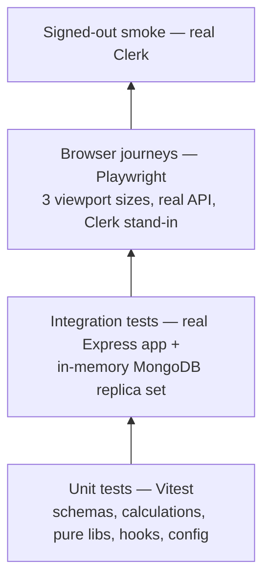

| Level | Proves | Does not prove |
|---|---|---|
| Unit | Calculations (recurrence, installments, month scope, cash flow, budget rows), schemas, env validation, error handler | Database behaviour |
| Integration | Real routes and real MongoDB semantics: auth boundaries on **every** route (route list read from the app), per-user isolation, validation sweeps over every `:id` route, transactions, idempotency, categories, income/budgets | Real Clerk, Atlas, S3 |
| Browser journeys | Sign-in flow (stand-in), add bill, pay, subscription, installment, reminders, admin access, no horizontal scroll | Real Clerk, deployed config |
| Smoke | Landing page, redirects, metadata with real Clerk | Signed-in flows |

New routes are covered automatically by the boundary and validation sweeps, so adding an endpoint without an auth check or ID validation fails the suite. Details and commands: [TESTING.md](TESTING.md). Mocked versus real integrations: [MOCKED-VS-REAL.md](MOCKED-VS-REAL.md).

---

## 17. Architecture decisions

| # | Decision | Alternatives | Rationale and consequences |
|---|---|---|---|
| 1 | Clerk for identity | Self-hosted auth, Supabase | No password handling; fast to ship. Couples availability and cost to Clerk. |
| 2 | Single Express file for routes | Per-resource routers | Fast to navigate for one developer and easy for the route sweeps to enumerate; file is large. Split by resource when it grows further. |
| 3 | Lazy generation of recurring bills and reminders | Cron / worker | No scheduler to host or monitor. Work happens on read; results are idempotent. Reminders do not fire when the user is away (no email/push). |
| 4 | Server generates to next month; client projects beyond | Generate a year ahead; fully client-side | Bounded writes, accurate future views. Projections are virtual (cannot be edited until generated). |
| 5 | Compute income occurrences, budgets and cash flow in the browser | Server aggregation endpoints | One consistent month view, fewer endpoints, no stored derivatives to go stale. Figures are unavailable to non-browser clients. |
| 6 | Categories in MongoDB, referenced by slug | Hard-coded enum | Admin control without deploys; slugs are immutable and deletion is blocked while in use. Needs one lookup per validation (cached list is small). |
| 7 | Category `kind` is global | Per-user mapping | Simple, consistent; users cannot reclassify (planned as a per-user override). |
| 8 | Budget "spent" = bills in category | Separate expense ledger | Lean MVP; matches the app's data. Under-counts everyday spending until "log a spend" exists. |
| 9 | Settings stored per user with defaults when absent | Seed on signup | No write on first visit; GET always returns usable values. |
| 10 | Strict schemas plus per-route ownership filters | Generic ownership middleware | Explicit and testable; relies on the sweeps to catch omissions. |
| 11 | Real-database integration tests as the main safety net | Mocks only | Catches index, transaction and query bugs; needs a MongoDB binary download on first run. |
| 12 | Auto-reload on stale chunk errors | Versioned service worker | Solves the observed blank-page failure with ~50 lines; relies on a single guarded reload. |
| 13 | Rate limits in memory | Redis | Adequate for one instance; revisit when scaling out. |

---

## 18. Risks, limitations and roadmap

### 18.1 Known limitations

- No expense ledger: budgets reflect bills only.
- No household or shared accounts; one owner per record.
- Currency is assumed to be rupees; no multi-currency.
- Reminders are in-app only; no background jobs.
- Deleting a bill keeps its payments and notes.
- Default "Savings & investments" category appears only on a fresh database.
- Category type is global.
- No error tracking, alerting, database backups configured by the application, or Content-Security-Policy on the frontend.
- Rate limits are per instance; free-tier API sleeps when idle.
- Several `npm audit` advisories need major upgrades of dev/build tooling.

### 18.2 Risk register

| Risk | Likelihood | Impact | Mitigation |
|---|---|---|---|
| Frontend and API deployed out of sync | Medium | Blank pages or 404s on new calls | Release order (API first), auto-reload, post-deploy checklist |
| Uncommitted work never reaches the deploy branch | Occurred once | Missing features in production | Commit and push to `personal` before redeploying; verify the commit shown on both platforms |
| Clerk or Atlas outage | Low | Full outage | Status monitoring; no mitigation inside the app |
| Data loss | Low | High | Enable Atlas backups |
| Large histories slow the bill list | Low (household scale) | Medium | Month-range query parameters |
| An endpoint added without auth/validation | Low | High | Route sweep tests fail the build |

### 18.3 Roadmap (budgeting Phase 2 and beyond)

1. Quick "Log a spend" (an expense ledger) so budgets reflect everyday spending.
2. Savings **goals** with monthly set-aside (for example a school-fee fund of ₹1,35,000 three times a year ≈ ₹33,750 per month), feeding the Cash Flow "set aside" figure.
3. Household sharing (shared bills and budgets).
4. Configurable month start day (for example salary-day based months), budget rollover, alert toggles, per-user category type overrides.
5. Operational hardening: error tracking, alerts, backups, CSP, shared rate-limit store.
6. Optional email/push reminders with a scheduled job.

---

## 19. Glossary

| Term | Meaning |
|---|---|
| Bill occurrence | A single dated bill, either created by the user or generated from a series or plan |
| Series | A `RecurringSeries`: the template for a subscription's monthly bills |
| Cycle / billing cycle | A `YYYY-MM` month key identifying one occurrence of a series or income source |
| Projection | A virtual bill computed in the browser for a month that has no stored occurrence yet |
| Carried over | An unpaid bill from an earlier month shown in the current month |
| EMI | Equated monthly instalment: a bill from an installment plan or in the Loans category |
| Free to spend | Counted income minus bills minus money set aside for savings, for a month |
| Kind | A category's budget type: need, want or savings |
| Slug | Immutable URL-safe identifier of a category |
| Bootstrap admin | A Clerk user id listed in `ADMIN_CLERK_USER_IDS`, always an admin |
| Authorized party (`azp`) | The origin a Clerk token was issued to; must match `CLIENT_URL` |

---

## Appendix A. Endpoint security matrix

Legend. **Auth**: `public` no token; `user` signed-in user; `admin` admin only. **Ownership**: data is filtered by the caller's `userId`; other users' ids return 404. **Rate limit**: the general limit (1000 per 15 min per user or IP) applies to every `/api` route except health and ready; routes marked *strict* use 30 per 15 min.

| Method and path | Auth | Input validation | Ownership / notes |
|---|---|---|---|
| GET `/api/health`, `/api/ready` | public | none | No rate limit; reveals service name and DB state |
| GET `/api/site-settings` | public | none | Read-only; does not write; returns a pre-signed logo URL when S3 is used |
| GET `/api/pricing-tiers` | public | `includeHidden` = `"true"` only honoured for admins | Hidden tiers never returned to the public |
| GET `/api/users/me`, `/api/users/me/role` | user | none | Profile refresh from Clerk at most every 15 min; role computed each call |
| GET `/api/categories` | user | none | Global list |
| POST/PATCH/DELETE `/api/admin/categories[/:id]` | admin | zod strict; id shape | Unique name; in-use and last-active rules |
| GET `/api/admin/users` | admin | `limit` / `offset` (see S5) | Lists users from Clerk |
| POST `/api/admin/users/:id/grant-admin`, `/revoke-admin` | admin, *strict* | id; target must exist; no self-revoke | Bootstrap admins cannot be revoked |
| GET `/api/admin/summary` | admin | none | Counts only |
| POST/PATCH/DELETE `/api/admin/pricing-tiers[/:id]` | admin | zod strict; slug unique | |
| PATCH `/api/admin/branding`, `/api/admin/site-settings` | admin | zod strict; https logo URL; HSL values | |
| POST `/api/admin/branding/logo` | admin, *strict* | multipart; signature check; ≤ 2 MB | Stored under `branding/`; private bucket |
| GET/POST `/api/bills`, GET/PATCH/DELETE `/api/bills/:id` | user | zod strict; id shape; category must be active; `scope` allow-list | Ownership filter on every query |
| GET `/api/payments`, GET `/api/bills/:id/payments` | user | id shape | Ownership |
| POST `/api/bills/:id/payments` | user | zod strict; idempotency key; 4 s duplicate guard | Bill must belong to caller |
| GET/POST `/api/bills/:id/notes` | user | text 1–1000 | Bill must belong to caller |
| GET/POST `/api/installments`, GET/PATCH `/api/installments/:id`, POST `/api/installments/:id/cancel` | user | zod strict; `status` allow-list; transaction on create | Ownership |
| GET/POST `/api/subscriptions`, GET/PATCH/DELETE `/api/subscriptions/:id`, PATCH `/api/subscriptions/:id/cancel` | user | zod strict; `status`/`scope` allow-lists | Ownership |
| GET `/api/notifications`, `/api/notifications/unread-count`, PATCH `…/:id/read`, `…/read-all`, `…/:id/dismiss` | user | `status` = `unread` only; id shape | Ownership |
| GET/POST `/api/income`, PATCH/DELETE `/api/income/:id`, PUT `/api/income/:id/received` | user | zod strict; id shape; `cycle` = `YYYY-MM` | Ownership |
| GET `/api/budgets`, PUT/DELETE `/api/budgets/:slug` | user | slug shape; limit > 0 and ≤ 1e9; category must exist and be active | Per-user unique limit |
| GET/PUT `/api/budget-settings` | user | zod strict; split must total 100 | One document per user |
| any other path | n/a | n/a | JSON 404 |

The authentication, admin and validation columns are enforced for *every* route by the sweeps in `integration/auth-boundaries.test.ts` and `integration/request-validation.test.ts`; the matrix above was compiled from the route list in `server/src/index.ts`.
